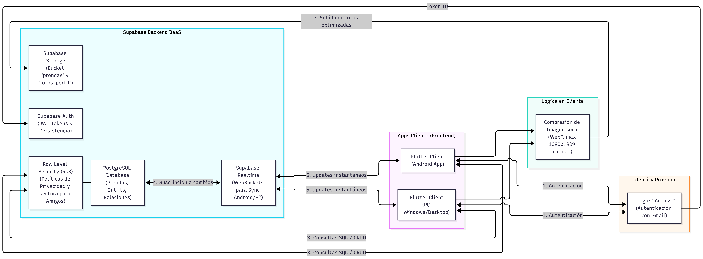

# Gum Armario Virtual

Aplicación multiplataforma (Android y PC) para digitalizar tu armario con fotos, probarte prendas sobre una foto tuya de cuerpo completo, armar outfits y recibir recomendaciones de tus amigos, con todo sincronizado en tiempo real entre tus dispositivos.

**Estado del proyecto:** en desarrollo. Por ahora el repositorio contiene la documentación, el diseño del sistema y el script de la base de datos. El código de la aplicación se publicará próximamente.

## Funciones principales

* **Inventario de prendas:** captura o carga de fotos (cámara y galería en Android, arrastrar y soltar en PC), con categoría, color y estilo obligatorios, búsqueda y filtros avanzados.
* **Probador virtual:** modo prenda aislada y modo puesta sobre tu foto de cuerpo completo, con un modelo neutro por defecto si prefieres no subir tu foto.
* **Outfits:** creación de combinaciones con reglas de validez (superior e inferior, o cuerpo completo), nombre y estilo obligatorios.
* **Módulo social:** amigos vinculados por Gmail que pueden armarte sugerencias de outfits sobre tu foto, para que las aceptes o las descartes.
* **Sincronización en tiempo real** entre Android y PC, con aviso de estado de conexión.

## Tecnologías

* Flutter (Dart) para los clientes Android y PC
* Supabase: Auth, Storage y Realtime
* PostgreSQL con Row Level Security (RLS) para la privacidad entre amigos
* Google OAuth 2.0 para el inicio de sesión con Gmail
* Compresión de imágenes en el cliente (WebP, máximo 1080p, calidad 80%)

## Arquitectura

  

Haz clic en la imagen para verla en tamaño completo.

El inicio de sesión se hace con Google OAuth y Supabase Auth emite el token JWT. Las consultas pasan por PostgreSQL con políticas RLS, de modo que solo el propio usuario y sus amigos confirmados pueden ver su información. Las imágenes se comprimen en el cliente antes de subirse a Supabase Storage, y Supabase Realtime mantiene los dispositivos sincronizados.

## Base de datos

  

Usé PostgreSQL sobre Supabase. La privacidad entre amigos se controla con Row Level Security directamente en la base de datos, y las reglas de los outfits y de las solicitudes de amistad se validan en funciones SQL. El script completo está en la carpeta BaseDeDatos.

## Documentación

* [Objetivos del proyecto](Documentos/Objetivos_Del_Proyecto.pdf)
* [Modelo de datos](Documentos/Modelo_De_Datos.pdf)
* [Script de la base de datos](BaseDeDatos/schema.sql)
* [Flujo de autenticación e inventario](Documentos/Diagramas/flujo_autenticacion_inventario.png)
* [Flujo del probador y creación de outfits](Documentos/Diagramas/flujo_probador_outfits.png)
* [Flujo del módulo social y sincronización](Documentos/Diagramas/flujo_social_sincronizacion.png)

## Próximos pasos

* Publicar el código de la aplicación
* Agregar capturas de pantalla e instrucciones para ejecutar el proyecto

## Autor

Andres Felipe Duran Perez