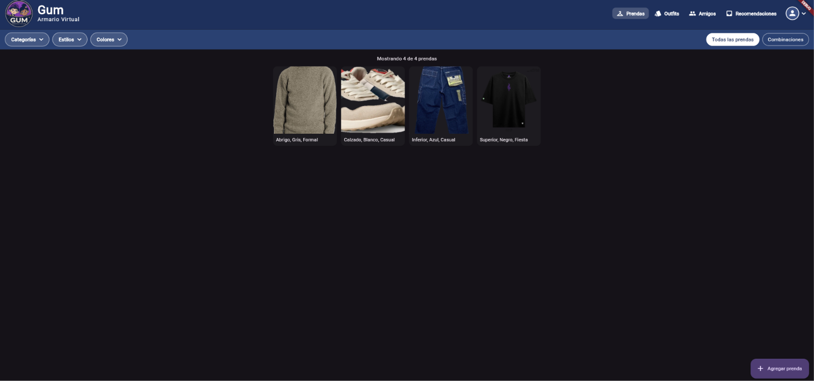
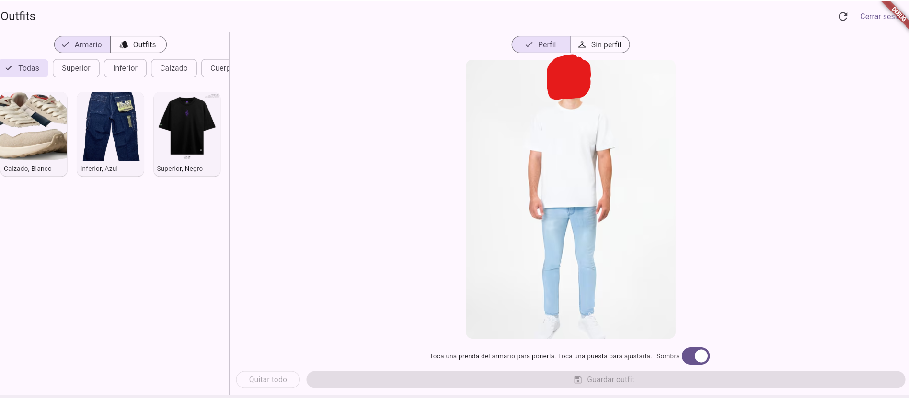
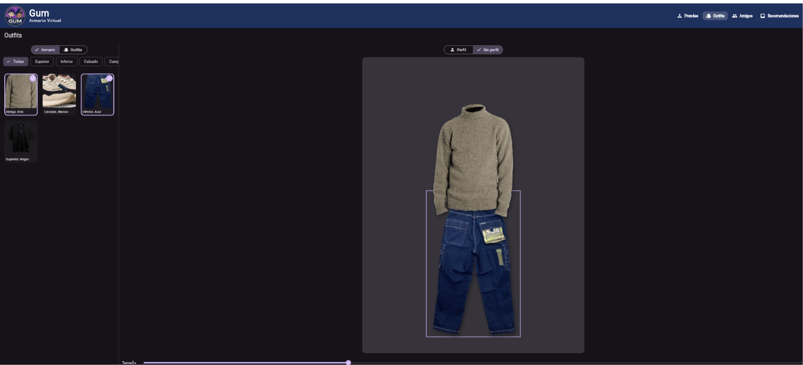
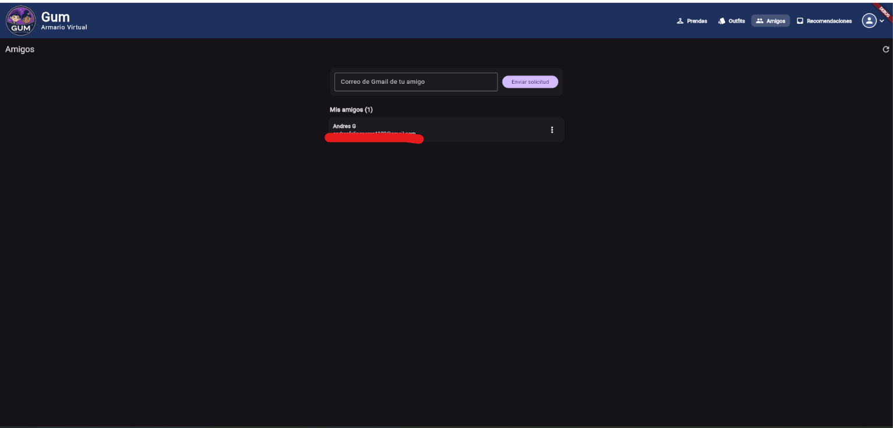
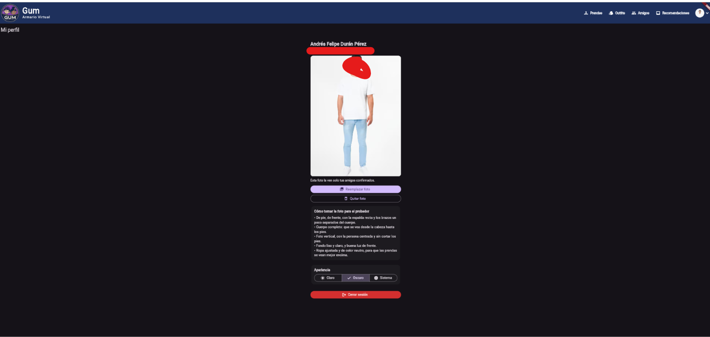
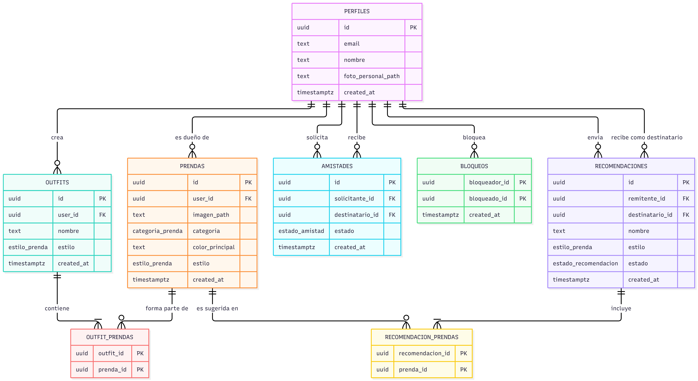

# Gum Armario Virtual

Aplicación para digitalizar tu armario con fotos, armar outfits probándote las prendas sobre una foto tuya de cuerpo completo o sobre un lienzo sin persona, y recibir recomendaciones de tus amigos, con los cambios sincronizados en tiempo real entre dispositivos.

**Estado del proyecto:** en desarrollo. La versión web ya cubre inicio de sesión, inventario, outfits, amigos, recomendaciones, foto personal y sincronización en tiempo real. La versión de Android y el probador con inteligencia artificial están pendientes.

## Lo que ya funciona

* **Inicio de sesión con Google** y creación automática del perfil.
* **Inventario de prendas:** alta con foto, categoría, color y estilo obligatorios, filtros, edición, reemplazo de la foto y eliminación con aviso de cuántos outfits se verían afectados.
* **Quitar el fondo de las prendas** al subir la foto, con una vista previa y un control de sensibilidad. La prenda se guarda como PNG con transparencia.
* **Editor de outfits:** el armario con sus categorías a un lado y el lienzo al otro. Con un toque se pone o se quita una prenda, y se puede acomodar, cambiar de tamaño, girar y voltear. Funciona sobre tu foto (modo Perfil) o sin persona (modo Sin perfil).
* **Outfits guardados** con las reglas de validez: superior e inferior, o cuerpo completo, y una prenda por categoría salvo accesorios.
* **Amigos por correo de Gmail:** enviar, aceptar, rechazar o cancelar solicitudes, eliminar amigos y bloquear usuarios.
* **Recomendaciones:** un amigo te arma un outfit con tus prendas y tú lo pruebas sobre tu foto, lo aceptas o lo descartas.
* **Perfil con foto personal** de cuerpo completo, que solo ven tus amigos confirmados.
* **Sincronización en tiempo real:** un cambio hecho en un dispositivo aparece en los demás sin recargar, y un aviso indica cuando se pierde la conexión.

## Capturas

<p>
  
  
</p>

<p>
  
  
</p>

<p>
  
  
</p>

## Tecnologías

* Flutter (Dart): versión web funcionando, versión de Android pendiente
* Supabase: Auth, Storage y Realtime
* PostgreSQL con Row Level Security (RLS) para la privacidad entre amigos
* Google OAuth 2.0 para el inicio de sesión con Gmail
* Procesamiento de imágenes en el cliente: reducción de tamaño y recorte del fondo claro de las prendas

## Arquitectura

<p align="center">
  
</p>

Haz clic en la imagen para verla en tamaño completo.

El inicio de sesión se hace con Google OAuth y Supabase Auth emite el token JWT. Las consultas pasan por PostgreSQL con políticas RLS, de modo que solo el propio usuario y sus amigos confirmados pueden ver su información. Las imágenes se procesan en el cliente antes de subirse a buckets privados de Supabase Storage, y Supabase Realtime avisa a los dispositivos cuando algo cambia.

## Base de datos

<p align="center">
  
</p>

Elegí PostgreSQL con Supabase y no MySQL con un backend propio porque el proyecto necesita guardar datos, guardar fotos y avisar al otro dispositivo cuando algo cambia. Supabase ya trae Auth, Storage y Realtime, y con Row Level Security la privacidad queda en la base de datos y no en código que se me pueda olvidar repetir. Los amigos confirmados pueden ver el catálogo porque una recomendación no tiene sentido si no ven la ropa, pero solo leen: no editan ni borran nada.

El orden secuencial de ejecución de los scripts debe actualizarse para reflejar el flujo final de despliegue:

1.schema.sql
2.amigos_funciones.sql
3.perfil_foto.sql
4.tiempo_real.sql
5.endurecimiento.sql

## Seguridad

* Todas las tablas tienen Row Level Security activado.
* Los outfits, las solicitudes de amistad y los bloqueos se crean solo a través de funciones de la base de datos, que validan las reglas antes de guardar.
* En las solicitudes de amistad, las recomendaciones y los perfiles, cada usuario solo puede modificar las columnas que le corresponden, nunca los identificadores ni el correo.
* Las imágenes están en buckets privados, con una carpeta por usuario, y se muestran con enlaces temporales.
* En la aplicación solo va la clave publishable de Supabase. La clave secreta no se usa y el archivo `env.json` no se sube al repositorio.
* Limitación conocida de Supabase Realtime: los avisos de borrado no pasan por RLS, así que se recibe el identificador de las filas borradas, sin ningún otro dato.

## Cómo ejecutarlo

Requisitos: Flutter (canal estable), un proyecto de Supabase y un cliente OAuth de Google Cloud.

1. Clona el repositorio.
2. En Supabase, abre el SQL Editor y ejecuta los scripts de `BaseDeDatos` en el orden indicado arriba.
3. En Supabase, en Authentication, activa el proveedor de Google con tu ID y secreto de cliente. Como Site URL usa `http://localhost:3000` y agrega `http://localhost:3000/**` en las Redirect URLs.
4. Copia `App/env.example.json` como `App/env.json` y completa la URL del proyecto y la clave publishable.
5. Desde la carpeta `App`, ejecuta:

```
flutter pub get
flutter run -d chrome --web-port=3000 --dart-define-from-file=env.json
```

## Documentación

* [Objetivos del proyecto](Documentos/Objetivos_Del_Proyecto.docx)
* [Modelo de datos](Documentos/Modelo_De_Datos.pdf)
* [Script de la base de datos](BaseDeDatos/schema.sql)
* [Flujo de autenticación e inventario](Documentos/Diagramas/flujo_autenticacion_inventario.png)
* [Flujo del probador y creación de outfits](Documentos/Diagramas/flujo_probador_outfits.png)
* [Flujo del módulo social y sincronización](Documentos/Diagramas/flujo_social_sincronizacion.png)
* [Revisión de seguridad](Documentos/Revision_De_Seguridad.md)

## Próximos pasos

* Revisión de seguridad de las políticas y documentación de sus resultados
* Versión de Android con inicio de sesión nativo
* Probador con modelo 3D y selección de maniquí para quien no tiene foto
* Probador con inteligencia artificial generativa, como función opcional
* Compresión de imágenes a WebP

## Autor

Andres Felipe Duran Perez