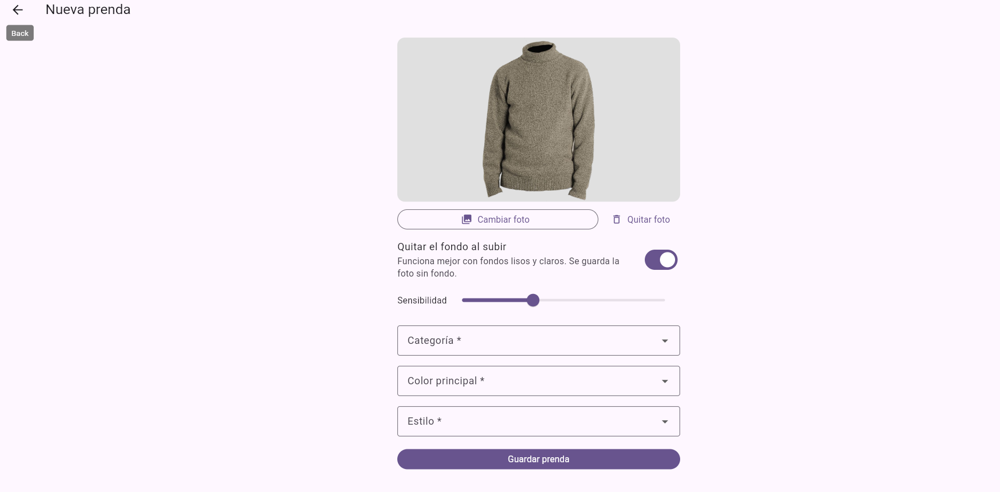

# Gum Armario Virtual

Aplicación multiplataforma (Android y PC) para digitalizar tu armario con fotos, probarte prendas sobre una foto tuya de cuerpo completo, armar outfits y recibir recomendaciones de tus amigos, con todo sincronizado en tiempo real entre tus dispositivos.

**Estado del proyecto:** en desarrollo. La versión web ya permite iniciar sesión con Google, gestionar el inventario de prendas y armar outfits. El módulo social, el probador virtual y la versión de Android están pendientes.

## Funciones principales

* **Inventario de prendas:** captura o carga de fotos (cámara y galería en Android, arrastrar y soltar en PC), con categoría, color y estilo obligatorios, búsqueda y filtros avanzados.
* **Probador virtual:** modo prenda aislada y modo puesta sobre tu foto de cuerpo completo, con un modelo neutro por defecto si prefieres no subir tu foto.
* **Outfits:** creación de combinaciones con reglas de validez (superior e inferior, o cuerpo completo), nombre y estilo obligatorios.
* **Módulo social:** amigos vinculados por Gmail que pueden armarte sugerencias de outfits sobre tu foto, para que las aceptes o las descartes.
* **Sincronización en tiempo real** entre Android y PC, con aviso de estado de conexión.

## Lo que ya funciona

* Inicio de sesión con Google y creación automática del perfil.
* Alta de prendas con foto, guardada en un bucket privado de Supabase Storage.
* Catálogo con filtros por categoría, estilo y color.
* Edición de prendas, con reemplazo de la foto, y eliminación con confirmación.
* Creación de outfits con validación de las reglas en la app y en la base de datos.
* Lista de outfits con las fotos de sus prendas.

## Capturas

<p>
  
  
</p>

<p>
  
  
</p>

## Tecnologías

* Flutter (Dart) para los clientes Android y PC
* Supabase: Auth, Storage y Realtime
* PostgreSQL con Row Level Security (RLS) para la privacidad entre amigos
* Google OAuth 2.0 para el inicio de sesión con Gmail
* Compresión de imágenes en el cliente (WebP, máximo 1080p, calidad 80%)

## Arquitectura

<p align="center">
  
</p>

Haz clic en la imagen para verla en tamaño completo.

El inicio de sesión se hace con Google OAuth y Supabase Auth emite el token JWT. Las consultas pasan por PostgreSQL con políticas RLS, de modo que solo el propio usuario y sus amigos confirmados pueden ver su información. Las imágenes se comprimen en el cliente antes de subirse a Supabase Storage, y Supabase Realtime mantiene los dispositivos sincronizados.

## Base de datos

<p align="center">
  
</p>

Elegí PostgreSQL con Supabase y no MySQL con un backend propio porque el proyecto necesita guardar datos, guardar fotos y avisar al otro dispositivo cuando algo cambia. Supabase ya trae Auth, Storage y Realtime, y con Row Level Security la privacidad queda en la base de datos y no en código que se me pueda olvidar repetir. Los amigos confirmados pueden ver el catálogo porque una recomendación no tiene sentido si no ven la ropa, pero solo leen: no editan ni borran nada.

## Cómo ejecutarlo

Requisitos: Flutter (canal estable), un proyecto de Supabase y un cliente OAuth de Google Cloud.

1. Clona el repositorio.
2. En Supabase, abre el SQL Editor y ejecuta el contenido de `BaseDeDatos/schema.sql`.
3. En Supabase, en Authentication, activa el proveedor de Google con tu ID y secreto de cliente. Como Site URL usa `http://localhost:3000` y agrega `http://localhost:3000/**` en las Redirect URLs.
4. Copia `App/env.example.json` como `App/env.json` y completa la URL del proyecto y la clave publishable.
5. Desde la carpeta `App`, ejecuta:

```
flutter pub get
flutter run -d chrome --web-port=3000 --dart-define-from-file=env.json
```

Importante: la clave secreta de Supabase no se usa en la app y nunca debe ir en `env.json`. El archivo `env.json` está en el `.gitignore` y no se sube al repositorio.

## Documentación

* [Objetivos del proyecto](Documentos/Objetivos_Del_Proyecto.docx)
* [Modelo de datos](Documentos/Modelo_De_Datos.pdf)
* [Script de la base de datos](BaseDeDatos/schema.sql)
* [Flujo de autenticación e inventario](Documentos/Diagramas/flujo_autenticacion_inventario.png)
* [Flujo del probador y creación de outfits](Documentos/Diagramas/flujo_probador_outfits.png)
* [Flujo del módulo social y sincronización](Documentos/Diagramas/flujo_social_sincronizacion.png)

## Próximos pasos

* Módulo social: amigos por Gmail, solicitudes y recomendaciones de outfits
* Foto personal y probador virtual
* Compresión de imágenes a WebP y sincronización en tiempo real
* Versión de Android con inicio de sesión nativo

## Autor

Andres Felipe Duran Perez
